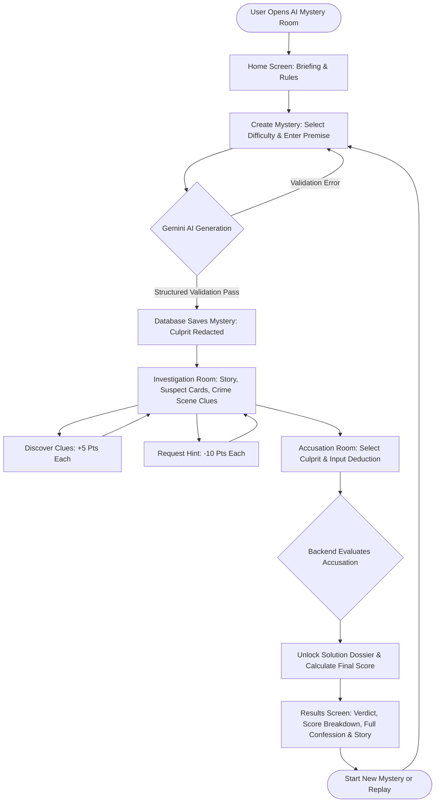

# AI Mystery Room — Technical Specification Document (SPEC.md)

**Project Name:** AI Mystery Room  
**Version:** 1.0.0  
**Status:** Approved for Implementation  
**Target Environment:** Node.js v18+, React 18/19, Vite, Tailwind CSS, Express, MongoDB/Mongoose, Gemini API  

---

## 1. Project Requirements

### 1.1 Project Overview & Problem Statement
Traditional mystery and detective games rely on pre-scripted branching narratives or static puzzle sets. Once solved, replayability drops to zero. **AI Mystery Room** solves this by dynamically generating infinite, logically coherent, interactive murder/heist mysteries using Google's Gemini generative AI models. 

Players assume the role of the Lead Detective. They investigate suspects, unlock physical and forensic clues, request timed hints from the precinct, and deduce who committed the crime before submitting a formal accusation.

### 1.2 Target Users & User Experience
* **Target Audience:** Mystery enthusiasts, casual puzzle gamers, escape room fans, and students/developers testing AI narrative generation.
* **Expected User Experience:**
  * **Atmospheric:** Noir-inspired, immersive detective board aesthetic with dark mode, amber and neon accent glows, typewriter text effects, and tactile audio cues.
  * **Interactive & Engaging:** Clues are not revealed all at once; players actively inspect crime scene items, interrogate suspect alibis, and track deductive progress.
  * **Fair & Logical:** Clues point toward the true culprit without logical contradictions or hallucinated solutions.
  * **Instant Feedback:** Immediate scoring breakdown and dramatic verdict reveal upon accusation.

### 1.3 Core Features & Optional Enhancements

#### Core Features (MVP)
1. **Dynamic Case Generation:** Custom premise input or curated presets (e.g., *Victorian Manor Poisoning*, *Cyberpunk Neon Syndicate Heist*, *Space Station Sabotage*, *Orient Express Art Theft*) across three difficulty tiers.
2. **AI-Structured Mysteries:** Gemini API prompt engineering with strict JSON schema validation guaranteeing exact numbers of suspects, clues, and hints per difficulty.
3. **Information Security Safeguards:** The true culprit, motive, and solution narrative are isolated exclusively in the backend database and stripped from all active game responses until the accusation is evaluated.
4. **Interactive Crime Scene & Clue Discovery:** Players uncover clues, triggering forensic notes and clue logs while accumulating investigative points.
5. **Precinct Hint System:** Progressive hint reveals with score penalty warnings to assist stuck players.
6. **Formal Accusation & Verdict Engine:** Backend validates the accused suspect, calculates the final score, unlocks the solution narrative, and renders a case resolution dossier.
7. **Score Breakdown:** Transparent calculation factoring base difficulty reward, clues discovered, hints deducted, with a zero floor.

#### Optional / Post-MVP Enhancements
* Audio ambiance (detective noir jazz soundscapes and synthetic audio effects using the Web Audio API).
* Detective Notebook / Scratchpad for player deductions.
* Case History / Hall of Fame storing completed investigations.
* Timed Investigation Mode (ticking clock countdown).

### 1.4 Technology Stack
| Layer | Technology | Rationale / Purpose |
| :--- | :--- | :--- |
| **Frontend Framework** | React 18/19 + Vite | Ultra-fast HMR, component modularity, modern React paradigms. |
| **Styling** | Tailwind CSS + Vanilla CSS | Modern responsive design, custom glassmorphism, detective noir palette. |
| **Routing** | `react-router-dom` v6 | Declarative client-side routing for seamless page navigation. |
| **HTTP Client** | Axios | Predictable HTTP requests with centralized error handling & base URL setup. |
| **Backend Framework** | Node.js + Express | Lightweight, extensible REST API architecture with middleware ecosystem. |
| **Database & ODM** | MongoDB + Mongoose | Flexible document model for variable mystery stories and nested clues/suspects. |
| **Database Fallback** | `mongodb-memory-server` / In-Memory Mock | Enables zero-configuration local testing even if a live Mongo cluster is temporarily absent. |
| **AI Integration** | `@google/genai` (Gemini SDK) | State-of-the-art Gemini 2.5/1.5 Flash structured outputs with JSON schema enforcement. |
| **Data Validation** | Zod | Runtime schema validation for AI generation outputs and client request payloads. |
| **Security & Utilities** | CORS, Dotenv, Helmet | Environment protection, Cross-Origin Resource Sharing, header security. |

### 1.5 Limitations & Final Deliverables
* **Limitations:** Requires an active internet connection for Gemini AI API calls. Gemini API rate limits apply; the system incorporates structured retries and fallback mock generation for resilience.
* **Deliverables:**
  * Complete source code organized in `client/` and `server/`.
  * Comprehensive technical specification (`SPEC.md`).
  * Backend and Frontend configuration files (`.env.example`).
  * Unit/Integration test suites verifying scoring, clue disclosure, and culprit privacy.
  * Live deployment instructions for Vercel (Frontend) and Render/Railway (Backend) with MongoDB Atlas.

---

## 2. User Flow



### Detailed Journey Steps:
1. **Landing & Orientation:** The user arrives at the Home Page, viewing active statistics, game overview, scoring system rules, and an "Enter the Precinct" call-to-action.
2. **Case Creation:** The user navigates to `/create`. They pick a difficulty (`Easy`, `Medium`, `Hard`) and either type a custom premise (e.g. *"A prestigious roboticist found unplugged inside a sealed cryogenic vault"*) or select a curated preset.
3. **AI Case Generation:** The client sends `POST /api/cases`. A loading state displays thematic detective status updates. The backend calls Gemini, verifies the schema with Zod, stores the complete case in MongoDB, and returns the case data with `culprit`, `solution`, and `isGuilty` fields completely stripped.
4. **Active Investigation:** The player navigates to `/cases/:id`.
   * Reads the case background story and incident overview.
   * Examines suspect dossiers (name, occupation, relationship, alibi, motive).
   * Clicks hidden crime scene points to discover clues (triggering `POST /api/cases/:id/clues/:clueId/discover`). Discovered clues unlock detailed forensic descriptions.
   * Can request precinct hints (`POST /api/cases/:id/hints`), which unlocks progressive hints while deducting 10 points.
5. **Accusation Submission:** When confident, the player clicks "File Formal Accusation" navigating to `/cases/:id/accuse`. The player selects the primary suspect and optionally records their deductive reasoning, then submits `POST /api/cases/:id/accuse`.
6. **Verdict & Case Dossier:** The backend verifies if the selected suspect ID equals the stored culprit. It sets `status = "solved"` or `"failed"`, tallies the final score (clues discovered, hints used, correct accusation bonus), and returns the full solution narrative.
7. **Results Page:** The user is redirected to `/cases/:id/results`, displaying a celebratory or somber verdict banner, score tally, the culprit's motive and confession, and a button to launch a new case.

---

## 3. UI and Page Specifications

### 3.1 Design System & Theme
* **Palette:**
  * Background: Slate/Zinc Deep Noir (`#090d16`, `#0f172a`, `#1e293b`)
  * Accents: Amber Gold (`#f59e0b`, `#fbbf24`), Detective Cyan (`#06b6d4`, `#38bdf8`), Crimson Alert (`#ef4444`, `#dc2626`), Emerald Verdict (`#10b981`)
  * Surface Cards: Glassmorphic borders with subtle backdrop blur (`bg-slate-900/80 backdrop-blur-md border border-slate-700/60`)
* **Typography:** Clean sans-serif (`Inter`, `system-ui`) paired with Monospace accents (`JetBrains Mono`, `Courier New`) for forensic evidence tags and terminal timestamps.
* **Icons:** Lucide React icons (`ShieldAlert`, `Search`, `Fingerprint`, `HelpCircle`, `Award`, `FileText`, `Sparkles`, `CheckCircle2`, `XCircle`).

### 3.2 Page-by-Page Elements

#### Page 1: Home Screen (`/`)
* **Header / Navigation:** Logo with crime scene badge, "Home", "New Case", GitHub/Docs link.
* **Hero Section:** High-impact typography: *"Every Crime Leaves a Digital Footprint. Can You Solve the Unsolvable?"*
* **How It Works (3 Steps):**
  1. *Prompt the AI:* Custom or preset premise.
  2. *Examine Evidence:* Interrogate suspects and uncover hidden forensic clues.
  3. *Unmask the Culprit:* Submit your verdict and earn your detective rank.
* **Scoring Rules Card:** Quick visual table showing Base Points, Discovery Bonus (+5), and Hint Deductions (-10).
* **CTA Button:** *"Start Investigation"* leading to `/create`.

#### Page 2: Create Mystery (`/create`)
* **Difficulty Selector (Tabs / Radio Cards):**
  * **Easy:** 3 Suspects, 5 Clues, 2 Hints (Base: 100 Pts). Recommended for rookies.
  * **Medium:** 4 Suspects, 7 Clues, 3 Hints (Base: 150 Pts). Standard detective challenge.
  * **Hard:** 5 Suspects, 9 Clues, 3 Hints (Base: 200 Pts). Complex web of deception and red herrings.
* **Premise Input:**
  * Textarea with placeholder: *"e.g., An antique collector was found locked inside their soundproof vault during an elite midnight gala..."*
  * Quick Premise Presets (Click-to-fill buttons):
    * 🏛️ *The Stolen Renaissance Masterpiece*
    * 🚀 *Sabotage on Orbital Station Apex-9*
    * 🍸 *The Midnight Poisoning at Gatsby Manor*
    * 💻 *Silicon Valley Source Code Murder*
* **Generation CTA:** Button with pulsing glow *"Generate Mystery with Gemini"*.
* **Loading State Modal:** Atmospheric radar scanning animation with cycling status logs:
  * *"Synthesizing criminal motives..."*
  * *"Fabricating suspect alibis..."*
  * *"Planting forensic traces and red herrings..."*
  * *"Encrypting the culprit dossier..."*

#### Page 3: Investigation Room (`/cases/:id`)
* **Case Header Bar:** Title, difficulty pill, case ID badge, live score counter, time elapsed.
* **Case Briefing Section:** Atmospheric narrative describing the incident, location, victim, and discovery circumstances.
* **Tabbed or Grid Investigation Workspace:**
  1. **Suspects Dossier Grid:**
     * Cards for each suspect showing Avatar, Name, Role, Relationship to Victim.
     * Expandable modal / accordion for **Alibi** and **Motive/Suspicious Behavior**.
     * Badge indicating: *"Under Investigation"*.
  2. **Crime Scene Clues Board:**
     * Interactive evidence cards. Undiscovered clues display a locked card with location/hint tag (e.g., *"Desk Drawer [Locked]"*).
     * Clicking "Inspect Clue" triggers discovery, unlocking full forensic description and awarding +5 points with visual toast notification.
  3. **Precinct Hint Terminal:**
     * Shows remaining hints (e.g., *"1 of 3 Used"*).
     * "Request Precinct Hint" button with confirmation alert (-10 points warning).
     * Unlocked hints displayed chronologically.
* **Bottom Action Bar:** "Review Evidence & File Accusation" CTA button leading to `/cases/:id/accuse`.

#### Page 4: Accusation Room (`/cases/:id/accuse`)
* **Case Summary Recap:** Key details and clues discovered so far.
* **Suspect Lineup Grid:** Interactive radio selection cards highlighting the chosen suspect with an amber/red spotlight border.
* **Deductive Theory Textarea:** Player inputs: *"Explain how the culprit committed the crime and which evidence proves it."* (encourages deliberate deduction).
* **Warning Notice:** *"Filing a formal indictment is final. You cannot alter your verdict once submitted."*
* **Submission Buttons:** "Return to Investigation" (Back) and "Submit Formal Accusation" (Triggers `POST /api/cases/:id/accuse`).

#### Page 5: Results Screen (`/cases/:id/results`)
* **Verdict Banner:**
  * **Success:** Green glowing banner *"CASE SOLVED — PERPETRATOR CONVICTED!"* with confetti effect.
  * **Failure:** Red glow banner *"CASE UNSOLVED — WRONGFUL ACCUSATION!"*
* **Detective Scorecard:**
  * Correct Accusation: `+100 / +150 / +200` (or `0` if incorrect).
  * Clues Discovered Bonus: `X × 5 = +Y pts`.
  * Hint Penalties: `Z × 10 = -W pts`.
  * **Final Score:** Displayed in large glowing badge with Detective Rank (e.g., *Novice Detective*, *Master Sleuth*, *Consulting Detective*).
* **The Truth Revealed (Full Solution Dossier):**
  * Identity of the True Culprit with portrait and criminal profile.
  * The Culprit's Confession & Motive.
  * How the Clues Connected: Bulleted forensic timeline explaining the decisive evidence vs. red herrings.
* **Action CTAs:** "Investigate Another Case", "Share Investigation Score", "Return Home".

---

## 4. Backend and Database Design

### 4.1 Database Model (`Case` Schema)
The Mongoose model handles active investigations and enforces the security boundary by default.

```javascript
// models/Case.js
import mongoose from 'mongoose';

const SuspectSchema = new mongoose.Schema({
  id: { type: String, required: true },
  name: { type: String, required: true },
  role: { type: String, required: true },
  relationship: { type: String, required: true },
  alibi: { type: String, required: true },
  motive: { type: String, required: true },
  avatarUrl: { type: String, default: '' },
  isCulprit: { type: Boolean, required: true, select: false } // NEVER returned in active game queries
});

const ClueSchema = new mongoose.Schema({
  id: { type: String, required: true },
  title: { type: String, required: true },
  location: { type: String, required: true },
  description: { type: String, required: true },
  isDiscovered: { type: Boolean, default: false },
  discoveredAt: { type: Date, default: null }
});

const HintSchema = new mongoose.Schema({
  id: { type: String, required: true },
  content: { type: String, required: true },
  isUsed: { type: Boolean, default: false },
  usedAt: { type: Date, default: null }
});

const CaseSchema = new mongoose.Schema({
  title: { type: String, required: true },
  story: { type: String, required: true },
  difficulty: { type: String, enum: ['Easy', 'Medium', 'Hard'], required: true },
  premise: { type: String, required: true },
  suspects: [SuspectSchema],
  clues: [ClueSchema],
  hints: [HintSchema],
  culpritId: { type: String, required: true, select: false }, // Private until accusation
  culpritName: { type: String, required: true, select: false }, // Private until accusation
  solution: { type: String, required: true, select: false }, // Private until accusation
  status: { type: String, enum: ['active', 'solved', 'failed'], default: 'active' },
  playerAccusation: {
    suspectId: { type: String, default: null },
    deduction: { type: String, default: '' },
    accusedAt: { type: Date, default: null }
  },
  score: {
    basePoints: { type: Number, default: 0 },
    clueBonus: { type: Number, default: 0 },
    hintPenalty: { type: Number, default: 0 },
    total: { type: Number, default: 0 }
  },
  createdAt: { type: Date, default: Date.now }
});

export const Case = mongoose.model('Case', CaseSchema);
```

### 4.2 Security Architecture: Information Redaction
To ensure players cannot cheat using browser Developer Tools (Network Tab / Inspect Element):
1. In the Mongoose schema, `culpritId`, `culpritName`, `solution`, and `suspects.isCulprit` are tagged with `select: false`.
2. Active game queries (`GET /api/cases/:id`, `POST /api/cases/:id/clues/:clueId/discover`, `POST /api/cases/:id/hints`) use default projections, omitting all solution fields.
3. For undiscovered clues, the backend replaces the `description` with `"[EVIDENCE UNEXAMINED]"` until the player explicitly calls the discover endpoint.
4. For unused hints, the backend replaces `content` with `"[HINT LOCKED]"` until the player explicitly invokes the hint endpoint.
5. Only upon completing an accusation (`POST /api/cases/:id/accuse`) or calling `GET /api/cases/:id/result` for a completed case does the backend fetch `+culpritId +culpritName +solution +suspects.isCulprit` and return the complete truth.

### 4.3 REST API Endpoints

#### 1. Generate Mystery
* **Endpoint:** `POST /api/cases`
* **Request Body:**
  ```json
  {
    "premise": "The curator of the Neo-Tokyo gallery was found incapacitated in the vault.",
    "difficulty": "Medium"
  }
  ```
* **Validation:** `difficulty` must be `"Easy" | "Medium" | "Hard"`. `premise` must be a string (10 - 500 characters).
* **Response (201 Created):**
  ```json
  {
    "success": true,
    "case": {
      "_id": "6724a8...",
      "title": "The Cipher of the Neon Lotus",
      "story": "On a rainy Tuesday night...",
      "difficulty": "Medium",
      "suspects": [
        { "id": "s1", "name": "Akira Vance", "role": "Head Archivist", "relationship": "Colleague", "alibi": "...", "motive": "..." }
      ],
      "clues": [
        { "id": "c1", "title": "Shattered Cryo-Vial", "location": "Vault Floor", "isDiscovered": false }
      ],
      "hints": [
        { "id": "h1", "isUsed": false }
      ],
      "status": "active"
    }
  }
  ```

#### 2. Retrieve Active Mystery
* **Endpoint:** `GET /api/cases/:id`
* **Response (200 OK):** Returns the case data with discovered clues, unlocked hints, current score tally, and stripped solution fields.

#### 3. Discover Clue
* **Endpoint:** `POST /api/cases/:id/clues/:clueId/discover`
* **Logic:** Finds the clue inside the case by `clueId`. If not yet discovered:
  * Marks `isDiscovered = true`, sets `discoveredAt = new Date()`.
  * Returns the revealed clue title, location, description, and the updated clue score (+5 pts).
* **Response (200 OK):**
  ```json
  {
    "success": true,
    "clue": {
      "id": "c1",
      "title": "Shattered Cryo-Vial",
      "location": "Vault Floor",
      "description": "Chemical residue matches synthetic neuro-toxin batches only accessible by the Head Archivist.",
      "isDiscovered": true
    },
    "clueBonus": 5
  }
  ```

#### 4. Request Precinct Hint
* **Endpoint:** `POST /api/cases/:id/hints`
* **Logic:** Finds the next unused hint in sequence.
  * Marks `isUsed = true`, sets `usedAt = new Date()`.
  * Deducts 10 points from running tally (floored at zero).
  * Returns the unlocked hint content.
* **Response (200 OK):**
  ```json
  {
    "success": true,
    "hint": {
      "id": "h1",
      "content": "Notice the security card timestamp: someone entered with an override code at 23:42.",
      "isUsed": true
    },
    "hintsRemaining": 2,
    "hintPenalty": 10
  }
  ```

#### 5. Submit Accusation
* **Endpoint:** `POST /api/cases/:id/accuse`
* **Request Body:**
  ```json
  {
    "suspectId": "s1",
    "deduction": "Akira used the override code to enter the vault and shatter the cryo-vial."
  }
  ```
* **Logic:**
  * Checks if `case.status !== 'active'`. If already submitted, returns error.
  * Fetches `culpritId` from DB.
  * Computes `isCorrect = (suspectId === case.culpritId)`.
  * Computes final score:
    * Base: Easy = 100, Medium = 150, Hard = 200 (if `isCorrect`, else 0).
    * Clues Discovered: `count(isDiscovered) × 5`.
    * Hints Used: `count(isUsed) × 10`.
    * `totalScore = Math.max(0, basePoints + clueBonus - hintPenalty)`.
  * Updates `case.status = isCorrect ? 'solved' : 'failed'`.
  * Saves score, accused suspect, and returns the complete result including `solution` and `culprit`.
* **Response (200 OK):**
  ```json
  {
    "success": true,
    "verdict": "solved",
    "isCorrect": true,
    "culpritId": "s1",
    "culpritName": "Akira Vance",
    "solution": "Akira had orchestrated the heist to cover up fabricated restoration receipts...",
    "score": {
      "basePoints": 150,
      "clueBonus": 35,
      "hintPenalty": 10,
      "total": 175
    }
  }
  ```

#### 6. Retrieve Completed Result
* **Endpoint:** `GET /api/cases/:id/result`
* **Logic:** If case is still `'active'`, returns 403 Forbidden with message: *"Accusation must be submitted before solution can be viewed."* If solved or failed, returns full result dossier.

---

## 5. AI Behavior and Scoring Rules

### 5.1 Difficulty Specifications Matrix
| Metric | Easy | Medium | Hard |
| :--- | :---: | :---: | :---: |
| **Number of Suspects** | 3 | 4 | 5 |
| **Number of Clues** | 5 | 7 | 9 |
| **Number of Hints** | 2 | 3 | 3 |
| **Base Accusation Points** | 100 pts | 150 pts | 200 pts |
| **Decoy / Red Herring Clues** | 1 | 2 | 3 |
| **Deduction Complexity** | Direct physical link | Alibi contradiction & timing | Multiple conflicting motives & deceptive alibis |

### 5.2 Gemini Prompt Engineering & Schema Enforcement
Gemini is invoked via the modern `@google/genai` SDK using `gemini-2.5-flash` (or `gemini-1.5-flash` fallback). We instruct the model to act as a master mystery writer and enforce structured JSON output:

```javascript
// System Instruction
const SYSTEM_PROMPT = `
You are an expert mystery writer and forensic puzzle architect. You craft captivating, logically watertight murder mysteries and criminal puzzles.
Rules:
1. Exactly ONE suspect is the true culprit.
2. The culprit's guilt MUST be logically deducible from the discovered clues.
3. Innocent suspects must have solid alibis or explanations uncovered by clues.
4. Include red herrings according to difficulty level, but ensure the true clues indisputably point to the culprit.
5. All IDs must be concise (e.g., "s1", "s2", "c1", "c2", "h1", "h2").
6. The output must strictly follow the required JSON structure.
`;
```

#### JSON Output Schema (Zod Validation)
```javascript
const MysteryGenerationSchema = z.object({
  title: z.string().min(5),
  story: z.string().min(50),
  culpritId: z.string(),
  culpritName: z.string(),
  suspects: z.array(z.object({
    id: z.string(),
    name: z.string(),
    role: z.string(),
    relationship: z.string(),
    alibi: z.string(),
    motive: z.string(),
    isCulprit: z.boolean()
  })),
  clues: z.array(z.object({
    id: z.string(),
    title: z.string(),
    location: z.string(),
    description: z.string(),
    isRedHerring: z.boolean().optional()
  })),
  hints: z.array(z.object({
    id: z.string(),
    content: z.string()
  })),
  solution: z.string().min(50)
});
```

### 5.3 Backend Scoring Algorithm
```javascript
function calculateScore({ isCorrect, difficulty, discoveredCluesCount, hintsUsedCount }) {
  let basePoints = 0;
  if (isCorrect) {
    switch (difficulty) {
      case 'Easy': basePoints = 100; break;
      case 'Medium': basePoints = 150; break;
      case 'Hard': basePoints = 200; break;
      default: basePoints = 100;
    }
  }

  const clueBonus = discoveredCluesCount * 5;
  const hintPenalty = hintsUsedCount * 10;
  const rawTotal = basePoints + clueBonus - hintPenalty;
  const total = Math.max(0, rawTotal);

  return {
    basePoints,
    clueBonus,
    hintPenalty,
    total
  };
}
```

---

## 6. Acceptance Criteria

| ID | Criterion | Verification Method |
| :--- | :--- | :--- |
| **AC-01** | Mystery generation functions across all 3 difficulties (Easy: 3 suspects, 5 clues, 2 hints; Medium: 4 suspects, 7 clues, 3 hints; Hard: 5 suspects, 9 clues, 3 hints). | Unit tests & manual generation verify exact counts matching difficulty matrix. |
| **AC-02** | Security barrier: Culprit, solution, and `isCulprit` flags are never sent over the network during active game state. | Inspect browser Network tab response for `POST /api/cases` and `GET /api/cases/:id` to confirm zero solution leaks. |
| **AC-03** | Interactive clue discovery reveals evidence descriptions and grants +5 points per clue. | Click locked clue card; verify description unmasks and score increments. |
| **AC-04** | Precinct hints reveal sequentially and deduct 10 points per hint. | Request hint; verify deduction reflects in score, with zero floor. |
| **AC-05** | Submitting accusation evaluates correctly against the secret culprit on the backend. | Test selecting true culprit (yields Solved verdict + base points) and false suspect (yields Failed verdict + 0 base points). |
| **AC-06** | Final results view displays complete solution, culprit identity, explanation, and score breakdown. | Complete investigation; verify Results page presents all forensic debrief sections. |
| **AC-07** | Graceful error handling for missing API keys, network hiccups, or invalid AI responses. | Verify fallback generation or friendly UI notification if Gemini API is unreachable. |
| **AC-08** | Responsive, high-fidelity UI optimized for desktop, tablet, and mobile browsers. | Test on multiple screen breakpoints with dark-mode noir aesthetic. |

---

## 7. Project File Structure

```
ai_mystery/
├── SPEC.md                           # This Technical Specification
├── README.md                         # Project documentation & setup guide
├── client/                           # Frontend React Application
│   ├── index.html
│   ├── package.json
│   ├── vite.config.js
│   ├── tailwind.config.js
│   ├── postcss.config.js
│   └── src/
│       ├── main.jsx
│       ├── App.jsx
│       ├── index.css
│       ├── api/                      # Axios client configuration
│       │   └── client.js
│       ├── components/               # Reusable UI components
│       │   ├── Navbar.jsx
│       │   ├── Footer.jsx
│       │   ├── SuspectCard.jsx
│       │   ├── ClueCard.jsx
│       │   ├── HintModal.jsx
│       │   ├── ScoreBadge.jsx
│       │   └── LoadingOverlay.jsx
│       ├── pages/                    # Core Route Pages
│       │   ├── HomePage.jsx
│       │   ├── CreateMysteryPage.jsx
│       │   ├── InvestigationPage.jsx
│       │   ├── AccusationPage.jsx
│       │   └── ResultsPage.jsx
│       └── utils/                    # Audio synthesizer & helpers
│           ├── soundEffects.js
│           └── presets.js
└── server/                           # Backend Express Application
    ├── package.json
    ├── .env.example
    ├── server.js
    ├── src/
    │   ├── config/
    │   │   ├── db.js                 # MongoDB connection & in-memory fallback
    │   │   └── gemini.js             # @google/genai SDK configuration
    │   ├── models/
    │   │   └── Case.js               # Mongoose schema with hidden culprit
    │   ├── routes/
    │   │   └── caseRoutes.js         # REST endpoints for mysteries
    │   ├── controllers/
    │   │   └── caseController.js     # Business logic & scoring
    │   ├── services/
    │   │   ├── geminiService.js      # Structured AI mystery generation
    │   │   └── mockGenerator.js      # Resilient fallback mystery provider
    │   └── utils/
    │       └── scoring.js            # Scoring algorithm
```
